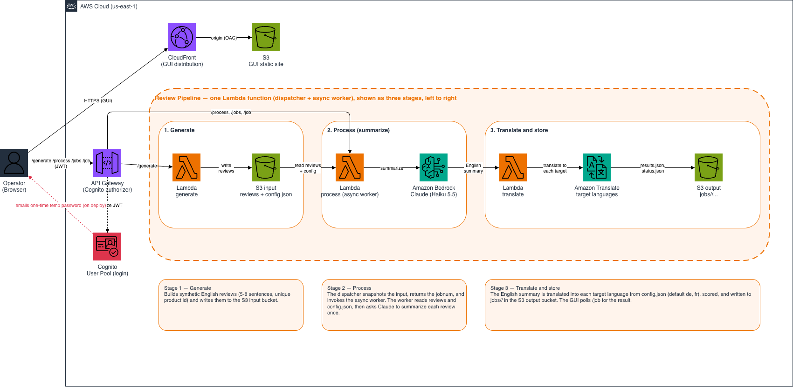

# Review Translate-and-Summarize Pipeline

A portable, self-contained proof of concept for AnyCompany Apparel. It takes
English product reviews, summarizes each into a tight 1–2 sentence overview
with Amazon Bedrock, and translates that summary into the target shopper
languages (**German** and **French**) with Amazon Translate — applying a
quality-scoring check at each step so low-quality output is filtered out.

Everything runs in AWS. The GUI is served from CloudFront and talks to an
API Gateway + Lambda backend; a user signs in via Amazon Cognito. Non-production,
synthetic (no-PII) data only.

---

## Architecture



> The diagram above is exported from `arc_draio.xml` (open it in
> [draw.io](https://app.diagrams.net), then export a PNG to `arc_draio.png`).
> The ASCII sketch below is the text fallback.

```
Browser GUI (CloudFront)                 sign in with Cognito (JWT)
      │  /generate · /process · /jobs · /job        (Authorization: JWT)
      ▼
Amazon API Gateway  ──(Cognito authorizer)──►  Lambda (pipeline)
      │                                            │
      │  generate ─► synthesize reviews ─────────► input bucket
      │  process  ─► create jobnum, snapshot input, async self-invoke,
      │              return jobnum immediately
      │                 └─ worker: summarize (Bedrock) → translate de+fr
      │                    (Amazon Translate) → score → write results
      ▼                                            ▼
   output bucket:  jobs/<jobnum>/inputs/samples.json
                   jobs/<jobnum>/results/results.json
                   jobs/<jobnum>/status.json
```

Per review the pipeline does:

1. **Summarize** the English review into 1–2 sentences (Amazon Bedrock).
2. **Translate** that summary into **de** and **fr** (Amazon Translate).
3. **Quality-score** the summary and each translation; a review is "surfaced"
   only if every step passes the threshold (default 0.7).

Each run is a **job** with a unique id (`job-YYYYMMDD-HHMMSS-<rand>`, UTC).
Processing is **asynchronous**: `process` returns the jobnum right away and the
work runs in a background Lambda invocation (up to the function's 10-minute
timeout), so large runs don't hit the API Gateway 29-second limit. The GUI
polls / auto-refreshes to show results when the job completes.

The browser never holds AWS credentials or calls AWS directly — it calls API
Gateway, authenticated with the Cognito JWT from login. On deploy, Cognito
emails the login user a one-time temporary password; the user sets their own
permanent password on first sign-in.

The S3 object-created trigger exists in the template but is **OFF by default**
(`EnableS3Trigger`); processing is driven from the GUI/API. The CloudFormation
template under `infrastructure/` is a handoff artifact the customer's team can
adapt — scaling and hardening are their own separate effort, out of scope for
this proof of concept.

---

## Layered structure

The pipeline follows a strict layered architecture (dependencies point inward):

```
review-pipeline/
├── pipeline/                         # Python — core pipeline
│   ├── src/
│   │   ├── model/                    # dataclasses: Review, StepResult, PipelineResult
│   │   ├── client/                   # thin AWS SDK wrappers (Translate, Bedrock)
│   │   ├── service/                  # orchestration, quality scoring, synthetic data
│   │   ├── api/                      # Lambda handler + optional local control plane
│   │   ├── config.py                 # static settings + config.json resolution
│   │   └── debug.py                  # debug-logging toggle (from config.json)
│   ├── scripts/                      # generate_synthetic.py, run_local.py (offline aids)
│   ├── tests/                        # unit + integration (no AWS)
│   └── pyproject.toml
├── gui/                              # TypeScript (React + Vite) job browser
├── infrastructure/
│   ├── template.json                 # CloudFormation (full stack)
│   ├── config.json                   # runtime model + debug config (seeded to input bucket)
│   ├── deploy.sh                     # package + deploy + publish GUI
│   └── teardown.sh                   # delete everything
└── README.md
```

- **model** — plain data structures, no logic, no dependencies.
- **client** — one wrapper per AWS service (Translate, Bedrock). Knows nothing
  about the pipeline. The Bedrock client auto-detects Claude vs. Amazon Nova
  request/response shapes.
- **service** — orchestration, quality scoring, and synthetic data generation.
  The only layer that knows the full flow.
- **api** — thin adapters. `lambda_handler.py` runs in AWS and routes the
  actions (generate / process / _worker / jobs / job). `local_app.py` is an
  optional local control plane that proxies to the same Lambda (for running the
  GUI locally instead of from CloudFront).

### Runtime configuration (`config.json`)

The deploy seeds `infrastructure/config.json` to the input bucket. The Lambda
reads it on each run, so you can change behavior **without redeploying** by
editing it in S3:

- `default_model` — the Bedrock model/inference-profile id to use. Options are
  listed under `models` (Claude Haiku 5.5 US/global, Amazon Nova 2 Lite).
- `debug` — `true` (default) emits verbose debug logging to CloudWatch.

> Claude and Nova models on the `bedrock-runtime` endpoint require a geo/global
> **inference profile id** (e.g. `us.anthropic.claude-haiku-5-5`), not a bare
> model id. Ensure the chosen model's access is enabled in Bedrock.

---

## Prerequisites

- Python 3.12, Node 18+, npm, AWS CLI
- AWS credentials in your environment (env vars, profile, or SSO)
- **Bedrock model access enabled** for the summarization model
  (`us.anthropic.claude-haiku-5-5` by default) in your deploy region
- The AWS identity used for deploy needs permissions for CloudFormation, S3,
  Lambda, API Gateway, Cognito, CloudFront, IAM, Translate, and Bedrock

Set up the Python environment (installable package; no path hacks):

```bash
cd review-pipeline
python3 -m venv .venv
.venv/bin/pip install -e "pipeline/[dev,local]"
```

Extras: `dev` adds pytest; `local` adds FastAPI/uvicorn for the optional local
control plane. The Lambda zip bundles only `src/` and uses the boto3 already in
the Lambda runtime, so neither extra ships to AWS. `pipeline/requirements.txt`
is a pinned mirror for tools that expect it.

Make the scripts executable (or invoke them with `bash infrastructure/<name>.sh`):

```bash
chmod u+x infrastructure/deploy.sh infrastructure/package_lambda.sh infrastructure/teardown.sh
```

---

## What the scripts do

Two scripts under `infrastructure/` manage the whole lifecycle.

### `deploy.sh`

Packages the code, provisions the stack, and publishes the GUI — idempotent, so
re-running it updates in place. In order:

1. **Package the Lambda** — zips `pipeline/src/` (via `package_lambda.sh`) and
   names the S3 key with a content hash, so the function reliably redeploys
   whenever the code changes.
2. **Ensure the code bucket** — derives an account-scoped bucket
   (`review-pipeline-code-<account-id>`), creating it (private + encrypted) if
   missing, and uploads the zip.
3. **Deploy the CloudFormation stack** — S3 buckets (input/output/GUI), the
   Lambda, API Gateway, the Cognito user pool + client, CloudFront, and IAM.
4. **Seed `config.json`** to the input bucket (model selection + debug flag).
5. **Invite the Cognito login user** (when `API_AUTH=COGNITO`) — Cognito
   generates a one-time temporary password and **emails it to the user**.
   Nothing is stored locally; the user sets their own permanent password on
   first sign-in.
6. **Build and publish the GUI** — builds with the API URL + Cognito config
   baked in, syncs `gui/dist/` to the GUI bucket, and invalidates CloudFront so
   the new build serves immediately.
7. **Print outputs** — the stack outputs plus the CloudFront `GuiUrl` and login
   details, and an optional block for running the GUI locally against the same
   API.

### `teardown.sh`

Removes everything the deploy created, in a safe order. Destructive and
irreversible; prompts for a typed `yes` unless `FORCE=1`. In order:

1. **List the stack's resources** (visibility before deleting).
2. **Empty the stack-owned buckets** (input/output/GUI) — S3 will not delete a
   non-empty bucket, so this must happen before the stack delete.
3. **Delete the CloudFormation stack** and wait for completion (CloudFront
   deletion takes several minutes).
4. **Empty and delete the code bucket** (it is created outside the stack).
5. **Remove any local `.secrets/` leftover** (none is created now; this is a
   safety cleanup for older deploys).

---

## Deploy

One command builds and deploys everything: the Lambda, API Gateway, Cognito
user pool + login user, the S3 buckets, and the CloudFront-hosted GUI.

```bash
export REGION=us-east-1
bash infrastructure/deploy.sh you@example.com
```

Pass the Cognito login user's email as the first argument (or set
`GUI_USER_EMAIL`). Cognito emails that address a one-time temporary password.

- `REGION` should be the region where you enabled Bedrock model access.
- No bucket to pre-create — the script derives and creates an account-scoped
  code bucket (`review-pipeline-code-<account-id>`).
- The Lambda code key is content-hashed, so each deploy reliably updates the
  function.
- A login user is created in Cognito; **Cognito generates a temporary password
  and emails it to the user**. Nothing is printed to the terminal or written to
  disk. The user sets their own permanent password on first sign-in.
- The GUI is built with the API URL + Cognito config baked in, synced to its
  S3 bucket, and CloudFront is invalidated.

When it finishes, the stack outputs include **`GuiUrl`** (the CloudFront URL).

### Use it

Check the login user's **email** for a message from Amazon Cognito with the
one-time temporary password (check spam too). Open the `GuiUrl` and sign in
with the email and that temporary password. On first sign-in the GUI prompts
you to set your own permanent password (the Cognito `NEW_PASSWORD_REQUIRED`
flow). The temporary password stops working once you reset it, and no password
is ever stored by the deploy. Then:

1. **Generate** — creates a synthetic English review corpus in the input bucket.
2. **Process** — submits a job (returns immediately); the summarize + translate
   work runs asynchronously. The job list auto-refreshes every 2 minutes.
3. **Select a job** — browse its **Inputs** (the reviews) and **Results** (each
   review's English summary with its German and French translations).

An **activity log** at the bottom of the GUI shows which step is running.

> CloudFront can take 10–15 minutes to finish its first deploy before the GUI
> URL serves.

### Optional overrides

| Variable | Default | Purpose |
|---|---|---|
| `REGION` | CLI default → us-east-1 | Deploy region (match Bedrock access) |
| `API_AUTH` | `COGNITO` | `COGNITO`, `API_KEY`, or `NONE` (open; PoC only) |
| `ENABLE_S3_TRIGGER` | `false` | `true` lets input uploads auto-run a job |
| `BEDROCK_MODEL_ID` | Claude Haiku 5.5 | Fallback model when config.json is absent |
| `GUI_USER_EMAIL` | kenwalsh+cdejump@amazon.com | Cognito login user (emailed the temp password). Can also be the first positional arg. |
| `CODE_BUCKET` | account-scoped | Bucket that holds the Lambda zip |

> **Email delivery (temporary password).** The user pool uses Cognito's default
> email sender, which is rate-limited (~50/day) and intended for testing. If the
> invite does not arrive, check spam. For production, configure Amazon SES as the
> pool's email sender (verified sender identity, out of the SES sandbox) — a
> customer hardening step, out of scope for this proof of concept.
>
> On re-deploy the script re-sends the invite; this only works while the user
> has not yet set a permanent password. If they have, use the GUI's reset flow
> or delete the user and re-deploy.

---

## Tear down

Deletes the stack and empties all buckets (and cleans up any legacy local
`.secrets/`). Destructive and irreversible (set `FORCE=1` to skip the prompt):

```bash
export REGION=us-east-1
bash infrastructure/teardown.sh
```

CloudFront deletion takes several minutes. Pull anything you want to keep from
the output bucket first.

---

## Tests

Unit + integration tests run without AWS (clients are faked). Config comes from
`pipeline/pyproject.toml`:

```bash
cd pipeline
../.venv/bin/pytest        # add -v for per-test output
```

## Optional: offline local run

`pipeline/scripts/run_local.py` runs the pipeline on your machine against a
local reviews file (calling real Translate + Bedrock), writing to
`data/outputs/`. A debugging aid, separate from the deployed flow:

```bash
.venv/bin/python pipeline/scripts/generate_synthetic.py --count 20 \
  --output data/sample/reviews.json
cd pipeline
../.venv/bin/python scripts/run_local.py \
  --input ../data/sample/reviews.json --targets de,fr --limit 5
```

The GUI can also run locally (instead of CloudFront) by pointing it at the API
and starting the Vite dev server — see the deploy script's printed output for
the exact env block.

---

## Security notes

The project is scanned with ProtoShield (Semgrep, Bandit, Checkov, cfn-nag,
Gitleaks, a CVE scan, and an IAM least-privilege review). Decisions worth
knowing:

- **Dependencies are fully pinned.** `pipeline/requirements.txt` is an exact
  lock of direct and transitive packages. Unpinned transitive dependencies can
  resolve to old, vulnerable minimums, so re-generate the lock (see the header
  in that file) when bumping a direct dependency. The GUI is locked by
  `gui/package-lock.json`; `npm audit` reports no known vulnerabilities. The
  deployed Lambda uses the runtime's boto3 and bundles only `src/`.
- **Bedrock access is scoped to the models in `config.json`.** The Lambda role
  may invoke only Claude Haiku 5.5 (US and global inference profiles) and Nova 2
  Lite. Foundation-model ARNs keep a region wildcard because cross-Region
  inference profiles route to other Regions. **To enable another model, add it
  to `infrastructure/config.json` and to the `Bedrock` statement in
  `infrastructure/template.json`, then redeploy** — selecting an unlisted model
  in `config.json` alone fails with an access-denied error by design.
- **Translate uses `Resource: "*"` with a Region condition.** Amazon Translate
  text translation has no resource-level permissions to scope to, so the role
  is limited to the single action `translate:TranslateText` in the deploy
  Region. This is a known limitation, not an oversight; the customer can add
  organization-level controls (SCPs, CloudTrail monitoring) if needed.
- **No secrets in the repo or on disk.** Cognito generates and emails the
  one-time temporary password; the deploy never sees or stores it.
- **Not included in this proof of concept** (hardening for the customer's own
  production effort): S3/API Gateway/CloudFront access logging, S3 versioning,
  AWS WAF, a VPC for the Lambda, a dead-letter queue, reserved concurrency, and
  KMS-encrypted Lambda environment variables.

---

## Scope

**In scope:** English source reviews → summary → German + French translations,
synthetic data, quality evaluation, Cognito-protected GUI on CloudFront, IaC
the customer's team can adapt.

**Out of scope:** PDP redesign, real reviewer PII, production deployment and
hardening, languages beyond German and French. These are separate workstreams
owned by the customer's team.

---

© Amazon.com, Inc. or its affiliates.
This documentation is licensed under the Creative Commons Attribution 4.0
International License (CC BY 4.0): https://creativecommons.org/licenses/by/4.0/

Source code in this project is licensed under the Apache License 2.0; see the
repository-root `LICENSE` file.
